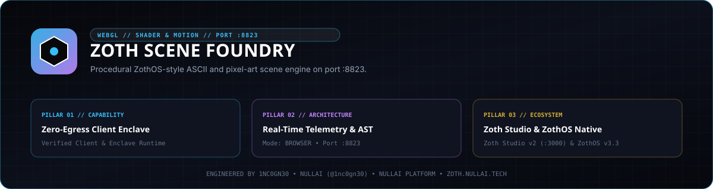

<div align="center">
  
</div>

# Zoth Scene Foundry

**Procedural ASCII, Ordered Bayer Dither & Pixel-Art Scene Engine (`v1.0.0`)**

- **Zoth Studio Dossier**: [https://zoth.nullai.tech/tools/zoth-scene-foundry](https://zoth.nullai.tech/tools/zoth-scene-foundry)
- **Local Workstation URL**: `http://127.0.0.1:8823`
- **Repository**: [https://github.com/1nc0gn30/zoth-scene-foundry](https://github.com/1nc0gn30/zoth-scene-foundry)
- **Author**: [1nc0gn30](https://1nc0gn30.si) (`@1nc0gn30`) • [NullAI](https://nullai.tech)

## Overview

Zoth Scene Foundry synthesizes 1,000 deterministic procedural ASCII, pixel-art, and 3D signed-distance-field (SDF) scenes (`ZS-0000` through `ZS-0999`) across 17 contact sheets. Because the core scalar-field, ordered Bayer dither, integer-upscaled pixel rasterizer, and software 3D/raymarch modules (`src/*.js`) run without DOM dependencies, Node.js (`export-foundry.js`) and the browser workstation (`public/index.html` + `gallery.html`) produce byte-identical outputs.

Core capabilities:
- **1,000 Deterministic Scenes**: Parametric geometric fields, raymarched 3D SDF panels (125 scenes), ordered Bayer dithering, and palette-snapped pixel-art PNG exports.
- **6 Cathode Tube Palettes**: `gold`, `amber`, `cyan`, `emerald`, `crimson`, and `obsidian` (`aurum_gold`, `retro_amber`, `cyber_cyan`, `sovereign_emerald`, `ghost_crimson`).
- **Dual Workstation & Contact Gallery**: Interactive synthesis stage at `http://127.0.0.1:8823` plus a searchable 1,000-scene contact sheet gallery at `http://127.0.0.1:8823/gallery.html`.

## Architecture

```text
zoth-scene-foundry/
├── server.py                        # ThreadingHTTPServer & telemetry API on 127.0.0.1:8823
├── bin/
│   ├── zoth-scene-foundry           # ZothOS v3.4.0 CLI (--status, --json, --scenes, --tubes, --synthesize, --serve)
│   └── zoth-scene-foundry-tui       # Unicode U+2800 Braille sparkline TUI & latency benchmark
├── src/
│   ├── zoth-fields.js               # Parametric 2D/3D scalar fields & SDF primitives
│   ├── zoth-ascii.js                # Glyph ramps & ordered Bayer dither quantizer
│   ├── zoth-pixel.js                # Palette-snapped pixel-art rasterizer
│   ├── zoth-three-soft.js           # Zero-DOM software 3D projection stage
│   ├── zoth-three-ascii.js          # Three.js AsciiEffect / 3D ASCII mesh adapter
│   └── zoth-foundry.js              # Deterministic 1,000-scene catalog orchestrator
├── export-foundry.js                # Headless Node batch exporter (JSONL, TXT, PNG, SVG sheets)
├── verify-foundry.js                # In-browser 1,000-scene invariant assertion script
├── public/                          # Browser workstation & gallery assets
└── tests/
    └── test_zoth_scene_foundry.py   # Pytest suite for HTTP endpoints and CLI synthesis
```

## Quickstart

```bash
git clone https://github.com/1nc0gn30/zoth-scene-foundry.git
cd zoth-scene-foundry
python3 server.py --port 8823
```

Open `http://127.0.0.1:8823` for the interactive workstation or `http://127.0.0.1:8823/gallery.html` to browse all 1,000 scenes.

## CLI & Batch Export Usage

### ZothOS v3.4.0 & Standalone CLI

```bash
# Inspect CLI flags and JSON status telemetry
./bin/zoth-scene-foundry --help
./bin/zoth-scene-foundry --status --json

# List cathode tube palettes and cataloged scene count
./bin/zoth-scene-foundry --tubes
./bin/zoth-scene-foundry --scenes

# Synthesize a deterministic Bayer 8x8 dither matrix from an integer seed
./bin/zoth-scene-foundry --synthesize 42

# Run the Unicode U+2800 Braille TUI benchmark
./bin/zoth-scene-foundry-tui --json
```

### Headless Node Batch Exporter

```bash
# Export a subset or all 1,000 scenes to out/ (JSONL, ASCII, PNG, SVG sheets)
node export-foundry.js out --limit 25 --scale 3
```

### REST API Endpoints (`127.0.0.1:8823`)

| Method | Endpoint | Description |
| :--- | :--- | :--- |
| `GET` | `/health`, `/api/health` | Daemon health status, version (`1.0.0`), and active port |
| `GET` | `/api/status` | Catalog scene count (`1000`), engine metadata, and tube palette list |
| `GET` | `/api/scenes` | Sample slice of indexed scene descriptors from `out/index.json` |

## Testing & Verification

```bash
# Run pytest suite (uses ephemeral port=0)
python3 -m pytest -q

# Verify server & CLI JSON telemetry
python3 server.py --status --json
./bin/zoth-scene-foundry --status --json
```

## Support

Zoth Scene Foundry is 100% free and open-source with zero paywalls or feature gates. Optional support: [Buy Us a Coffee (Stripe)](https://buy.stripe.com/3cIfZg27PdKo2D64Ocfw40X).

## License

Released under the [MIT License](LICENSE). Copyright (c) 2026 [1nc0gn30](https://1nc0gn30.si) & [NullAI](https://nullai.tech).
